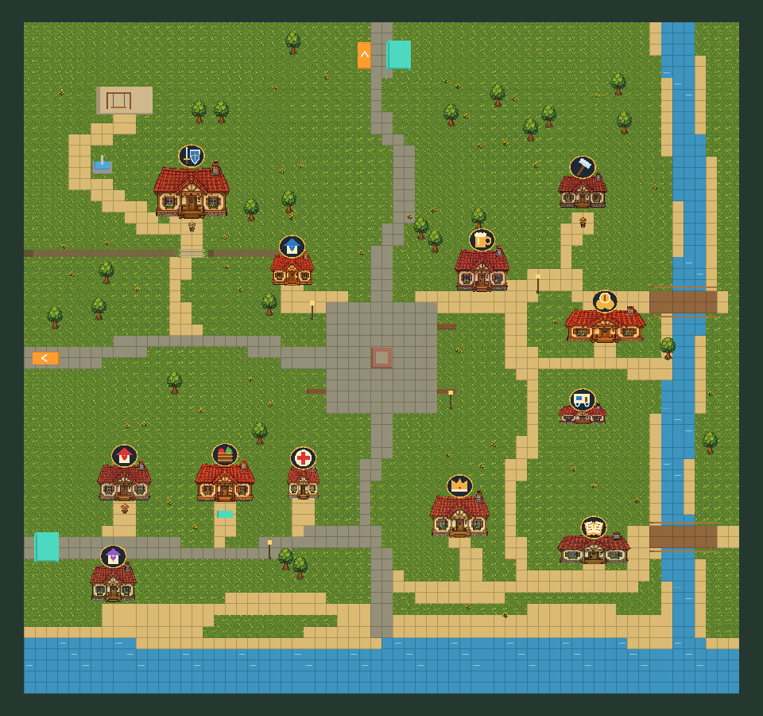
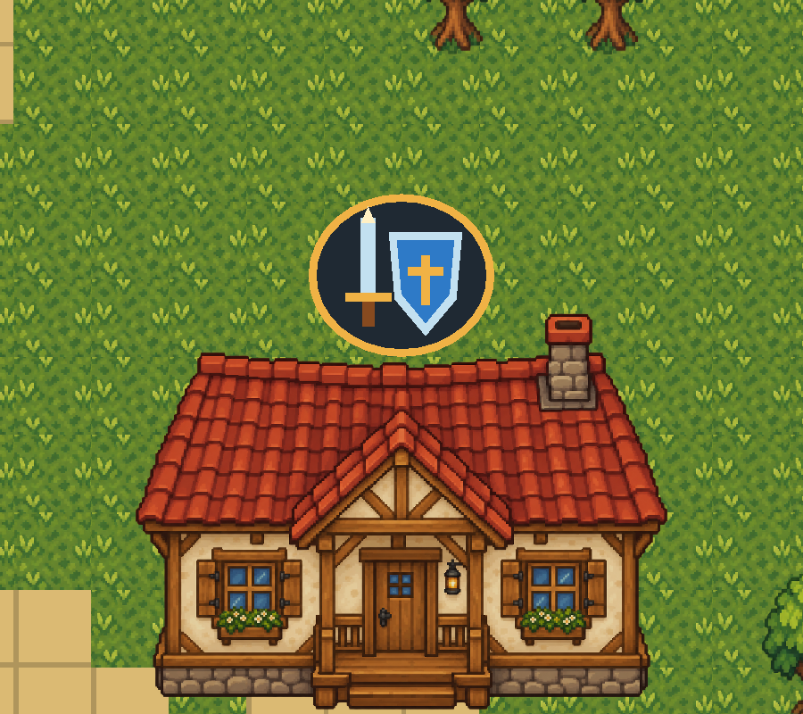

# 마을 배치 기준

## 최신 전체 월드 구조

2026-10-22 삼각형 동선으로 확장한다. 농장↔연결 통로↔마을, 농장↔던전 입구 필드↔마을을 연결하고 입구 필드에서 던전·숲·훈련장으로 진입한다. 마을의 주요 건물 배치는 아래 기준을 유지하되 던전 방향 입구를 길드 북쪽으로 옮긴다. 상세 씬과 편집 방법은 [TRIANGLE_WORLD.md](TRIANGLE_WORLD.md)를 따른다. 아래 네 씬·출입구 8개 설명은 변경 전 이력이다.

## 현재 기준: 사용자 위치 스케치 + 스타듀밸리 광장 분위기

2026-10-21 후속 요청: 펠리컨 타운을 기준으로 만든 마을에서 **주요 시설 위치는 사용자가 그린 그림으로 복원**하고, 중앙 광장의 돌바닥과 주변 마을 분위기는 유지한다. 이전의 펠리컨 타운 시설 위치를 그대로 쓰는 기준을 대신한다.

- [사용자 마을 위치 스케치](Images/TOWN_LAYOUT_SKETCH.png)
- [사용자 전체 연결 스케치](Images/WORLD_LAYOUT_SKETCH.png)
- [분위기를 참고한 펠리컨 타운 지도](https://images.squarespace-cdn.com/content/v1/64bf8ed4bcdd7401d84ca74a/76d01239-2dee-4fbf-ac61-f25fdc1516e6/1200px-Pelican_Town.png)

기존 프로젝트 에셋으로 만든 배치용 맵이며 원작의 건물·타일 아트를 가져오지는 않는다.

## 주요 배치

Town의 크기는 64×60을 유지한다.

| 구역 | 위치 | 중심 좌표 |
| --- | --- | --- |
| 길드 | 북서쪽 | (-17, 15) |
| 대장간 | 북동쪽 | (18, 15) |
| 돌바닥 광장 | 맵 중앙 | (0, 0) |
| 기존 주택 | 남서쪽 | (-23, -11) |
| 잡화점 | 기존 주택 오른쪽 | (-14, -11) |

광장은 넓은 돌바닥, 중앙 문양, 가장자리 벤치와 가로등으로 구성하고 가운데는 통행 공간으로 비운다. 이전 지도에서 북쪽 회관으로 표시했던 건물은 다시 길드로 표시한다.

주변 주택과 주점 외관은 광장 북쪽, 진료소 외관은 잡화점 근처, 큰 상점·트레일러 외관은 동쪽, 나머지 주택·박물관 외관은 남쪽에 분산한다. 추가 건물은 기존과 같이 외관용이며 새 서비스·실내·거래를 추가하지 않는다. 기존 잡화점은 GeneralStore 실내 및 구매·판매와 연결된다.

## 길과 지형

- 서쪽 농장 입구 → 중앙 광장으로 돌길을 연결한다.
- 중앙 광장 → 북쪽 던전 입구로 중심길을 연결한다.
- 광장 서쪽 길에서 북쪽 길드로 갈라지고, 동쪽 길에서 북쪽 대장간으로 갈라진다.
- 광장 남쪽 중심길과 남서쪽 주택·잡화점 앞 거리를 연결한다.
- 동쪽과 남쪽 주택에는 짧은 보조 길을 연결한다. 주택마다 별도의 순환 골목은 만들지 않되, 진입로의 방향과 꺾이는 지점을 조금씩 달리한다.
- 북서쪽 길드 주변에 공원·분수·놀이터를 유지한다.
- 동쪽 가장자리로 강을 옮겨 주요 시설이 강에 갈라지지 않게 한다. 다리 두 개와 강변길을 둔다.
- 남쪽은 모래 해안과 바다다. 바다와 다리 밖의 강에는 진입할 수 없다.

지역 간 이동은 주황색 접촉 통로만 사용한다. 건물 실내 출입용 청록색 E 문, 기존 도착 ID, 농장↔던전 직통 통로와 잡화점 실내 연결은 유지한다. 새 해변 지역이나 새로운 출입구 기능은 추가하지 않는다.

## Scene 편집

`Assets/Scenes/LegacyVillage/Town.unity`의 `EditableMap` 아래에서 편집한다.

- `Ground and paths`: 잔디·돌바닥·흙길·물·다리 바닥
- `Buildings`: 길드·대장간·기존 주택·잡화점
- `Town districts`: 추가 시설과 주택 외관
- `Plaza and decorations / Central village square`: 광장 문양·벤치·가로등
- `Plaza and decorations / Northwest guild park`: 공원·분수·놀이터·계단
- `Plaza and decorations / East river and south coast`: 물 충돌과 다리 난간
- `Plaza and decorations / Gardens and trees`: 나무·화단
- `Residents`: 기존 주민 3명
- `Travel` 등 이동 그룹: 출입구·도착 지점

오브젝트는 Scene에서 이동·삭제·교체할 수 있다. 건물의 MapObstacle은 그림과 별개인 발밑 충돌 영역이다. 출입구와 도착 위치를 옮길 때 Arrival Id는 유지한다.

`Tools > Everything Grows > World > Apply user sketch village square`는 이번 배치를 한 번 적용하는 메뉴다. 적용 마커가 있으면 재생성하지 않으므로 이후 수동 편집을 덮어쓰지 않는다. 이전 배치 메뉴의 적용 마커도 유지한다.

## 길의 굴곡 조정

후속 요청에 따라 건물·광장·출입구는 그대로 두고 기존 바닥 타일의 길 모양만 다듬었다.

- 서쪽 농장길은 광장 직전에 완만하게 꺾인다.
- 북쪽 던전길은 중간에 좌우로 조금씩 휘고, 남쪽 중심길도 주택가 쪽으로 기울었다가 돌아온다.
- 길드·대장간 진입로, 동쪽 주택가와 해안 산책길의 긴 직선을 몇 구간으로 나눈다.
- 돌길과 흙길의 재질 구분을 유지하고 흙길 폭에는 작은 변화를 준다.
- 중앙 돌바닥 광장과 시설 중심 좌표는 유지한다.
- 새 길에 걸리는 나무는 그림과 충돌 영역을 함께 길가로 옮긴다.

`Tools > Everything Grows > World > Apply village road bends`는 이 조정을 한 번 적용하는 메뉴다. 바닥과 장식만 수정하고 건물·주민·출입구를 다시 생성하지 않는다. 적용 마커가 있으면 반복해서 덮어쓰지 않는다.

## 미리보기

## 검증 결과

별도 Unity 프로젝트에서 출입구 12개 연결과 도착·출입구·NPC·추가 건물·공원·다리 접근점 26곳의 통행을 확인했다. 광장 중심과 길드·대장간·잡화점의 지정 위치, 다리 밖 강 이동 차단을 검사했다. 실제 Play에서 네 씬 왕복, NPC·상점, 농장↔던전 직통 통로, 작물·소지품·골드·자동 저장 상태 유지가 통과했다.

- 길 굴곡 조정 검증: 모든 예정 길의 중심선을 따라 장애물 통과 여부를 검사했고, 출입구 12개와 접근점 26곳 검사도 통과했다. 실제 Play에서 상점·맵 왕복과 인벤토리·골드·작물·자동 저장 상태 유지가 확인됐다. 동쪽 건물 모서리와 아래 다리 난간을 피하도록 꺾이는 지점을 조정했다.

## 건물 지붕 표식

2026-10-22 요청에 따라 현재 마을 건물 12채에 용도를 구분하는 지붕 표식을 추가한다.

| 건물 | 표식 |
| --- | --- |
| 길드 | 칼과 방패 |
| 대장간 | 망치 |
| 잡화점 | 작물이 든 상자 |
| 진료소 외관 | 십자 |
| 주점 외관 | 맥주잔 |
| 박물관 외관 | 펼친 책 |
| 일반 주택 세 채 | 집과 하트, 주택별 색 구분 |
| 관저 외관 | 왕관 |
| 트레일러 | 바퀴 달린 차량 |
| 큰 상점 외관 | 동전 |

금색 테두리와 어두운 배경 위에 밝은 기호를 얹어 지붕 색과 구분한다. 추가 시설의 표식은 기존 외관의 정체성을 표시하며 새 시설 기능을 추가하지 않는다.

각 건물 아래 `Roof identity`가 표식이다. 건물을 옮기면 함께 움직이며 표식만 위치·크기·회전을 바꿀 수도 있다. `Assets/Prefabs/Map/RoofSigns`의 프리팹으로 다른 건물에도 같은 표식을 추가할 수 있다. 구성 도형은 MeshFilter와 MeshRenderer이며 충돌 영역이 없다. 주요 시설의 기존 글자 안내는 표식 위로 올려 겹침을 줄인다.

`Tools > Everything Grows > World > Add town roof identity signs`는 표식이 없는 건물에만 추가하는 메뉴다. 이미 있는 표식의 수동 편집을 덮어쓰지 않는다.

- 지붕 표식 검증: 별도 프로젝트에서 건물 12채 모두 표식과 메시·재질 참조가 있는지 확인하고, 새 충돌 영역이 추가되지 않았는지 검사했다. 마을 전체·길드 확대 렌더링과 기존 출입구 12개 연결 검사가 통과했다.

## 지역 이동용 파란 문 제거

2026-10-22 요청으로 농장·마을·던전 사이의 E 문 4개를 제거했다. 기존 주황색 통로로만 이동하고, Town ↔ GeneralStore 실내의 E 문 2개는 유지한다. 이전 문에 사용했던 도착 ID는 저장·이전 참조를 위해 남긴다. 현재 네 씬의 출입구는 총 8개다.

별도 프로젝트의 실제 Play에서 자동 통로 왕복, 농장↔던전 직통 이동, 상점 E 출입·거래와 소지품·골드·작물·저장 상태 유지를 검증했다. 열린 유니티에서 농장 편집 내용을 보존하고 씬을 닫지 않은 채 적용했다.
